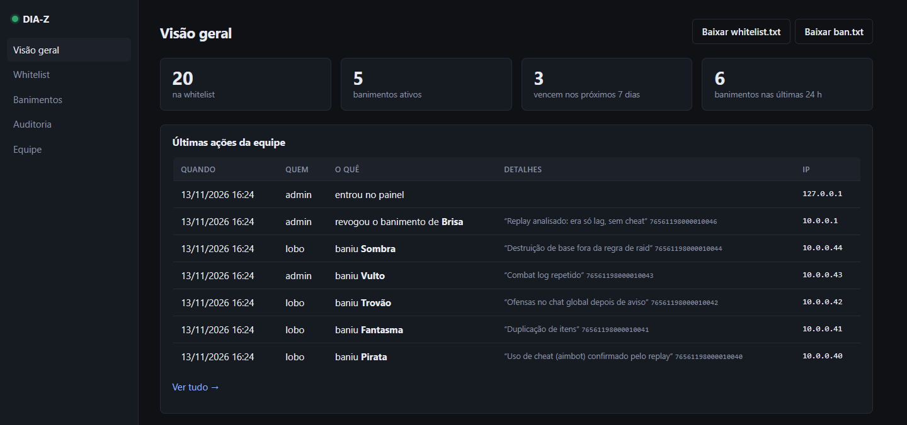
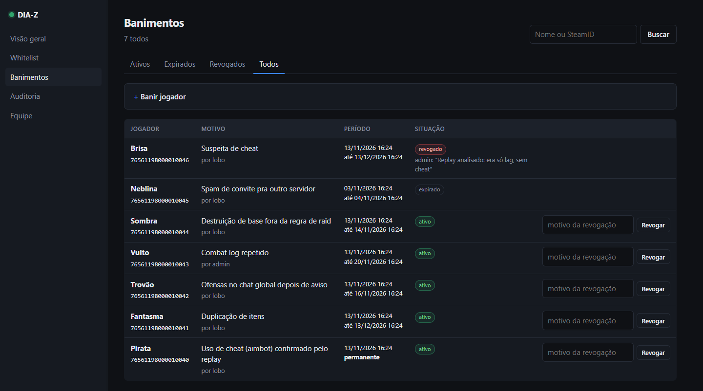

# Painel de administração de servidor (PHP puro)

Painel web pra equipe de um servidor de jogo cuidar de **whitelist**, **banimentos** e de quem tem
acesso a quê. Feito em PHP 8.3+ sem framework: roteamento, sessão, CSRF, 2FA e templates são
código deste repositório. A ideia foi entender o que um framework faz por baixo antes de usar um.



## O que tem

- **Whitelist**: aceita o SteamID64 ou o link do perfil da Steam colado direto, busca por nome ou ID, paginação.
- **Banimentos** de 1, 3, 7 ou 30 dias ou permanentes. Banimento nunca é apagado: ele expira ou é
  revogado, e a revogação exige motivo. O histórico do jogador fica inteiro.
- **Exporta `ban.txt` e `whitelist.txt`** no formato que o servidor de DayZ lê, só com o que vale no momento.
- **Equipe com cargos**: administrador faz tudo, moderador bane/revoga/exporta, suporte cuida da
  whitelist e só consulta banimentos.
- **Verificação em duas etapas (TOTP)** compatível com Google Authenticator, Authy, 1Password etc.
- **Auditoria**: login, erro de senha, bloqueio, cada inclusão, banimento, revogação, exportação e
  mudança de cargo fica registrado com quem, quando e de qual IP. O painel só insere nessa tabela.



## Segurança, item por item

| Ameaça | Como o painel trata |
|---|---|
| SQL injection | PDO com prepared statement real (`ATTR_EMULATE_PREPARES = false`); nenhum valor vindo do usuário é concatenado no SQL |
| XSS | todo dado vai pra página por `e()` (`htmlspecialchars`); CSP `default-src 'self'` sem script inline como segunda barreira |
| CSRF | token por sessão em todo formulário, conferido com `hash_equals`; cookie `SameSite=Lax` |
| Fixação de sessão | `session_regenerate_id` no login e na troca de senha; `use_strict_mode` recusa id inventado |
| Força bruta | 5 erros por usuário ou 20 por IP em 15 minutos bloqueiam novas tentativas; o bloqueio por IP não tranca o dono da conta vindo de outro lugar |
| Descobrir usuários pelo login | mesma mensagem pra usuário inexistente e senha errada, e com usuário inexistente o `password_verify` roda contra um hash de verdade, pra resposta demorar o mesmo tempo |
| Código do 2FA reaproveitado | cada intervalo de 30 s só vale uma vez: o `UPDATE` só passa se o passo for maior que o último usado, então nem dois logins simultâneos usam o mesmo código |
| Senha guardada | `password_hash` (bcrypt); hash antigo ou com custo menor é refeito no login, quando a senha está em mãos |
| Conta desativada com sessão aberta | o usuário é relido do banco a cada requisição: desativou, perdeu o acesso na hora |
| Ficar sem administrador | o último admin ativo não pode ser rebaixado nem desativado, e ninguém desativa a própria conta |
| Injeção no `ban.txt` | quebra de linha no nome do jogador é removida antes de gerar o arquivo (senão viraria uma linha com outro SteamID) |
| Busca com `%` e `_` | escapados no `LIKE`; buscar "100%" não devolve todo mundo |
| Dois moderadores banindo o mesmo jogador ao mesmo tempo | checagem e insert na mesma transação, com `GET_LOCK` no MySQL |

O `ESCAPE` do `LIKE` usa `!` em vez da barra invertida: no MySQL a barra já é escape dentro da
string SQL e no SQLite não, então `ESCAPE '\'` não funciona igual nos dois.

## Testes

44 testes (PHPUnit 12) que conversam com o painel pelo `App::handle()`, do mesmo jeito que o
`index.php`, só que sem servidor HTTP: cada teste tem banco novo, relógio controlado e uma sessão
em memória fazendo papel de navegador. Rodam em SQLite (padrão) e em MySQL, e o CI roda os dois.

Alguns dos casos:

- o fluxo inteiro do 2FA: ligar, login pedindo o código, o mesmo código recusado na segunda vez,
  sessão pendente expirando em 5 minutos
- os vetores de teste da RFC 6238 pro gerador de código
- bloqueio depois de 5 senhas erradas mesmo com a senha certa na sexta, e liberação depois de 15 minutos
- POST sem token CSRF recusado sem alterar nada
- nome `<script>` aparecendo escapado na página
- banimento de 7 dias deixando de valer no segundo exato do vencimento, e o jogador podendo ser banido de novo
- suporte recebendo 403 ao tentar banir ou exportar, e o rebaixamento valendo já na requisição seguinte

```
$ vendor/bin/phpunit
OK (44 tests, 169 assertions)

$ PAINEL_TEST_MYSQL="mysql:host=127.0.0.1" PAINEL_TEST_MYSQL_USER=painel PAINEL_TEST_MYSQL_PASS=... vendor/bin/phpunit
OK (44 tests, 169 assertions)
```

## Rodando

Precisa de PHP 8.3+ com `pdo_sqlite` ou `pdo_mysql`, e do Composer.

```bash
composer install
cp .env.example .env            # SQLite por padrão; troque o DSN pra usar MySQL
bin/console migrar
bin/console demo                # opcional: jogadores fictícios, usuários admin/lobo/raposa, senha "demonstracao123"
php -S localhost:8090 -t public public/index.php
```

Pra criar o primeiro administrador de verdade (a senha é lida da entrada, não fica no histórico do terminal):

```bash
bin/console usuario:criar seu_nome admin
```

Em produção, aponte o servidor web (Nginx/Apache com PHP-FPM) pra pasta `public/` e sirva por HTTPS:
o painel liga o cookie `Secure` e o HSTS sozinho quando a requisição chega por HTTPS.

## Estrutura

```
public/            index.php (front controller), CSS e o único JS (confirmação de ações)
src/
  App.php          monta as peças, CSRF, autenticação, rotas, cabeçalhos de segurança
  Http/            Request, Response, Router
  Security/        sessão, CSRF, Auth (login, bloqueio, 2FA), TOTP
  Domain/          usuários e cargos, whitelist, banimentos, auditoria, geração do ban.txt
  Controllers/     uma classe por área
  Db/              PDO e migrações
templates/         PHP puro, tudo escapado com e()
migrations/        mysql/ e sqlite/
bin/console        migrar, usuario:criar, demo
tests/             Unit/ e Feature/
```

## Licença

MIT
